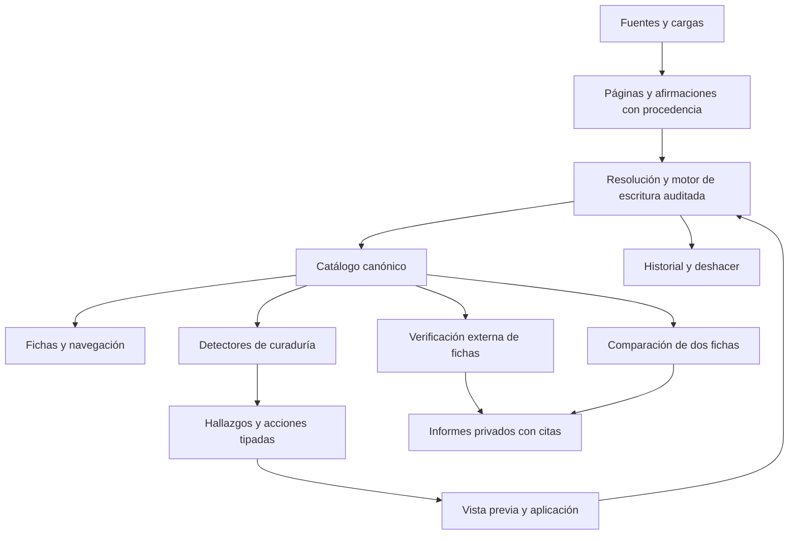

# Coleccionistas de Rock Venezolano: fichas, curaduría y verificación

Documento de contexto para analizar el sistema con otra IA. Fecha de revisión: **8 de octubre de 2026**. Basado en el código del workspace y las decisiones documentadas; describe capacidades implementadas, no una propuesta de desarrollo. No incluye contraseñas, claves, cookies, credenciales ni datos de configuración privados.

## 1. Cómo utilizar este documento

El sistema es un catálogo musical con fichas relacionadas y herramientas administrativas para conservar la procedencia, detectar problemas, investigar identidades y corregir datos con historial. Este documento concentra el funcionamiento de las fichas y la curaduría, y explica los módulos que las alimentan.

Los anexos incluyen los detectores y acciones registrados realmente en el código, campos del modelo, rutas HTTP y componentes. Una capacidad del backend no implica que todos sus campos tengan un control visible en la ficha. Se distingue entre datos almacenables, formularios de edición, investigación y aplicación de cambios.

La revisión fue de código y documentación. No se ejecutó un censo de la base de datos ni una nueva campaña de investigación web para elaborar este archivo. Los números del ejemplo Caramelos corresponden a su revisión documentada, no a estadísticas actuales de todo el catálogo. Los documentos antiguos pueden describir etapas anteriores: donde hay diferencias, prevalece la implementación indicada aquí.

## 2. Arquitectura y conceptos centrales

- Backend modular en TypeScript, Node.js 22, Fastify, validación Zod y PostgreSQL, con Drizzle y consultas SQL.
- Frontend React y Vite: búsqueda, listados, fichas y administración. Consume la API; no accede directamente a PostgreSQL.
- CLI para ingesta, merge, géneros, revisión, curaduría y operaciones. Comparte los motores del backend.
- Esquema `public`: catálogo canónico. Esquema `ingest`: fuentes, afirmaciones, conflictos, revisiones, auditoría e investigaciones. Esquema `media`: medios y enlaces de YouTube.
- HTML crudo, recursos localizados y reportes en disco. Los trabajos de investigación conservan estado en PostgreSQL.
- La IA propone interpretaciones o conclusiones; validadores y motores de escritura deciden qué evidencia y operaciones se admiten.



**Ficha**: entidad canónica. **Relación**: membresía, crédito, vínculo con organización o medio. **Claim**: afirmación de una fuente, con valor crudo y normalizado. **Conflicto**: dos afirmaciones incompatibles sobre un campo. **Hallazgo**: señal emitida por un detector. **Run**: operación registrada. **Informe**: resultado de investigación separado del catálogo.

Hay tres evaluaciones distintas:

| Proceso | Pregunta que responde | Resultado | ¿Modifica por sí solo el catálogo? |
|---|---|---|---|
| Curaduría interna | ¿Hay anomalías, contradicciones, duplicados o datos mal estructurados? | Hallazgos y acciones disponibles | Detectar no; aplicar una acción sí |
| Verificación individual | ¿Qué datos coinciden o discrepan con evidencia externa? | Informe y puntaje condicionado a datos contrastados | No |
| Comparación entre fichas | ¿Son la misma identidad, relacionadas, distintas o inconclusas? | Matriz comparativa e informe conjunto | No; la fusión es otra operación |

## 3. Acceso y permisos

El catálogo se puede consultar públicamente. Las cuentas `reader` mantienen acceso de lectura. Las cuentas `admin` acceden a las funciones de curaduría y escritura. La protección se aplica en el servidor, además de ocultar controles en la interfaz.

La autenticación utiliza sesiones aleatorias en cookie HttpOnly, validación de contraseñas con scrypt y protección CSRF en las escrituras con sesión. Existe autenticación bearer para automatizaciones configuradas. El nombre del operador acompaña la auditoría. El código contempla integración de cuentas con Herra y limitación de intentos de acceso.

Son privadas las lecturas de curaduría, revisión, candidatos a duplicado, informes individuales y comparaciones, auditoría e historial de cambios, y vistas previas de fusión. La sesión de un lector no lo convierte en administrador. Referencia: `src/api/auth.ts`.

## 4. Navegación y búsqueda

La página inicial es la búsqueda. Hay listados de artistas, discos, personas y organizaciones, con paginación y filtros según el tipo. Artistas y discos incluyen búsqueda por texto y selección jerárquica de géneros (familia, subgénero, estilo y relacionados). Personas permiten filtrar nombres sospechosos y ordenar por nombre o cantidad de créditos; organizaciones filtran por nombre. Los administradores pueden iniciar altas desde los listados. Los resultados enlazan a fichas; una pista se abre dentro de su disco, porque no tiene página independiente en la SPA.

Rutas principales: `/artistas`, `/discos`, `/personas`, `/organizaciones`; detalle con `/:id`. La curaduría vive bajo `/curaduria`, y el historial general en `/historial`. El despliegue utiliza el prefijo `/crv`; las rutas anteriores son las internas del enrutador. Hay rutas antiguas que redirigen a las secciones actuales.

Las fichas muestran estados de carga, ausencia de datos, errores recuperables y entidades retiradas o fusionadas. Las redirecciones de ids fusionados conservan la navegación y muestran el cambio de destino. La ausencia de una imagen o de una relación se representa como dato faltante, sin fabricar contenido.

## 5. Ficha de artista

### 5.1 Datos y presentación

La entidad representa una banda, solista, dúo, proyecto, grupo u otro tipo. Su modelo contiene nombre, biografía, foto, ciudad y país de origen, formación y disolución, notas, estado, temas, texto de años activos y logo. Los campos ampliados del modelo no están todos en el formulario genérico.

La ficha presenta identidad, foto y logo ampliables, biografía expandible, alias, géneros, enlaces para escuchar y redes sociales. Sus secciones son:

- **Discografía**: tarjetas con título, tipo, año y portada; navegación al disco.
- **Miembros**: personas, roles y periodos; una persona puede tener varios roles. La presentación agrupa filas de la misma persona.
- **Artistas relacionados**: vínculos por linaje, miembros, colaboraciones e invitados, con motivos visibles cuando están disponibles.
- **Artistas similares**: agrupación según género, época o escena. Es una recomendación de navegación, no una prueba de identidad.
- **Enlaces**: enlaces asociados a los discos, agrupados por plataforma.
- **Historial**: cambios de la entidad.

### 5.2 Operaciones administrativas

Editar datos básicos, fusionar con otro artista, retirar la ficha y gestionar alias. En miembros: añadir, editar persona/rol/periodo/estado actual y retirar una membresía. Las operaciones registran cambios y permiten revisar su historial.

El informe individual y la comparación están integrados en la ficha para administradores. Una banda y una persona integrante siguen siendo entidades distintas: la relación de membresía no justifica absorber una dentro de la otra.

Código principal: `web/src/pages/ArtistDetailPage.tsx`, repositorio de artistas, `src/api/routes/artists.ts`, rutas de escritura y `src/merge`.

## 6. Ficha de disco

### 6.1 Datos y secciones

Un disco pertenece a un artista. Guarda título, año, tipo, género legado, sello, portada, descripción, notas y enlaces/estados de publicación. El modelo también contempla fecha literal de lanzamiento, identificador de catálogo y formato de medio.

Tipos editables: `studio_album`, `live_album`, `ep`, `single`, `compilation`, `demo`, `soundtrack`, `collaboration_album`, `remix`, `other`. Una edición puede tener formatos asociados y datos distintos de otro lanzamiento con un título parecido.

La ficha contiene alias, lista de pistas, créditos del disco, formatos, medios de YouTube e historial. Las pistas muestran soporte, número, título, duración y créditos desplegables. El inicio en YouTube permite relacionar una pista con una posición temporal del video.

Los créditos pueden apuntar a persona, artista u organización, y conservan tipo, rol y notas. Un crédito técnico no debe importarse como título de pista. Los capítulos de DVD necesitan conservar el soporte y su numeración, aunque aparezcan junto al listado del CD en una fuente.

### 6.2 Operaciones administrativas

Editar, fusionar discos, retirar disco, gestionar alias; añadir/editar/retirar pistas y sus alias; gestionar créditos mediante los componentes y rutas de relaciones; añadir/editar/retirar formatos. La fusión de discos tiene vista previa propia y tratamiento de pistas y relaciones.

Los créditos se agrupan en músicos, colaboradores/invitados, producción (producción, grabación, mezcla y masterización), composición, arte (diseño y fotografía) y otros. Los formatos tienen calidad HQ/LQ/desconocida, estado de archivo, ruta de archivo y notas.

La clasificación del disco y sus formatos son conceptos diferentes: un álbum de estudio puede publicarse en CD, LP o digital. La clasificación procedente de una carga de YouTube puede conservar varias etiquetas; una etiqueta audiovisual no equivale automáticamente a un álbum nuevo.

Código principal: `web/src/pages/AlbumDetailPage.tsx`, `src/api/routes/albums.ts`, `src/merge/album-merge.ts`.

## 7. Ficha de persona

Guarda identidad, biografía, foto, nacionalidad, condición venezolana, nacimiento, fallecimiento, indicador de fallecida y notas. El modelo extendido contempla nombre real, ciudad de nacimiento, causa de muerte, trivia y género; el formulario genérico expone un subconjunto.

Sus pestañas son bandas/proyectos con rol y periodo, créditos de disco, créditos de pista, organizaciones e historial. Abre inicialmente la primera pestaña que tiene relaciones. El indicador de fallecimiento es independiente de tener una fecha exacta.

Un administrador puede editar, fusionar, dividir una ficha que mezcló personas, retirar y convertir una persona mal tipada en artista u organización. Los vínculos con organizaciones incluyen rol y periodo y se gestionan desde ambas fichas.

Incluye señales de identidad y comparaciones guardadas. La investigación de pares de personas y la investigación especializada sobre una persona posiblemente mezclada son flujos propios, además de la verificación individual general. No deben interpretarse como la misma puntuación o el mismo motor.

Código: `web/src/pages/PersonDetailPage.tsx`, `PersonIdentitySignals`, `PersonPairWebResearch`, `SplitPersonModal`, `ConvertPersonModal`, `src/ambiguity/persons.ts`, `person-pair-research.ts`, `person-web-verification.ts`.

## 8. Ficha de organización

Representa sello, productora, estudio, distribuidor, management u otro tipo. Guarda nombre, clasificación, biografía, imagen, web, país y notas.

Muestra discografía asociada como sello, artistas acreditados, personas relacionadas y su historial. Permite editar, fusionar, retirar, gestionar alias y los vínculos persona–organización. La primera pestaña con datos se abre por defecto.

**Alcance actual**: las organizaciones tienen ficha y curaduría, pero no están incluidas en `VerificationKind` del verificador individual ni en el comparador general de `src/verification`; este admite persona, artista y disco.

## 9. Edición, relaciones, fusiones y reversibilidad

Las rutas de escritura validan campos y pasan por operaciones auditadas, generalmente dentro de `withOperatorRun`. La interfaz no escribe SQL directamente.

- Las entidades principales tienen crear, editar y retirar mediante API y los controles correspondientes.
- Membresías, vínculos con organizaciones, créditos de disco/pista y formatos tienen operaciones específicas.
- Alias preservan otras escrituras del nombre o título y su procedencia.
- Una fusión elige ficha conservada y absorbida, muestra valores, relaciones y colisiones y conserva el rastro de referencias movidas y filas descartadas.
- Los claims no se eliminan simplemente por colisionar en una fusión: pueden quedar `superseded`, conservando la evidencia.
- Las revisiones que enfrentaban las dos entidades necesitan desasociación controlada; no se convierten en una comparación de una ficha consigo misma.
- Una división distribuye relaciones hacia las personas del plan. Una conversión corrige el tipo de entidad y conserva el rastro del origen.
- Las reescrituras textuales tras fusión son una operación explícita y auditada; no se debe asumir que fusionar sustituye automáticamente cualquier mención textual.
- Retirar una entidad verifica sus dependencias; no equivale a borrar sin revisar relaciones.

El historial general agrupa runs y su detalle; el historial de campos conserva antes/después y procedencia. Deshacer produce otra operación auditable. Se verifican precondiciones y cambios posteriores: la reversibilidad no autoriza sobrescribir correcciones nuevas. Algunas operaciones antiguas necesitan rastros reconstruidos y pueden no ser reversibles.

Referencias: `src/merge/operator.ts`, `entity-merge.ts`, `album-merge.ts`, `journal-undo.ts`, `run-undo.ts`, `audit-undo.ts`, `legacy-trace.ts`, `redirects.ts`.

## 10. Curaduría: organización de la interfaz

La sección privada reúne panorama de conflictos, categorías, hallazgos filtrados, revisión de ingesta, posibles duplicados, portadas/fotos, correcciones y autocorrección.

El menú de categorías se construye a partir del resumen de la API y sus recuentos; no es una lista estática desconectada del catálogo. Se actualiza periódicamente y al recuperar el foco. Durante un análisis, la frecuencia de consulta aumenta. En móvil, el menú se pliega.

| Categoría | Qué reúne |
|---|---|
| Nombres sucios | Invisibles, espacios, codificación, HTML y signos defectuosos |
| Mal segmentados | Varios datos en un campo: artista en título, duración, créditos, alias, región o varias personas |
| Ficha de otro tipo | Persona que es estudio, sello, banda o texto inválido; otros tipos mal asignados |
| Fichas repetidas | Candidatos a repetición de artistas, organizaciones, discos o pistas |
| Datos incoherentes | Años, duraciones, tipos, numeración y relaciones incompatibles |
| Valores en disputa | Afirmaciones divergentes de fuentes |
| Revisión de ingesta | Casos que la importación no resolvió automáticamente |
| Fichas sin vínculos | Entidades sin referencias relevantes |
| Otros | Anomalías del perfil del catálogo y tipos no mapeados |

Los posibles duplicados de personas tienen bandeja propia. Un caso nuevo no desaparece por no tener categoría: cae en Otros.

## 11. Motor de detección

Versión actual de reglas internas: **`curation-rules.v6`**. El núcleo de análisis es puro: recibe una foto del catálogo, construye índices y vocabulario y ejecuta detectores; otro módulo consulta PostgreSQL y persiste hallazgos.

Los detectores locales evalúan una entidad y su vecindad inmediata, usando el vocabulario global aprendido. Los globales necesitan todo el catálogo: candidatos a duplicado, cola/conflictos, determinadas relaciones y anomalías generales. La verificación dirigida tras una corrección no puede resolver hallazgos globales que no evaluó.

El análisis conserva qué detectores terminaron y cuáles fallaron. Un análisis parcial solo resuelve lo realmente comprobado. Hay control de concurrencia, registro de análisis completo/dirigido, firma del catálogo para cambios y seguimiento incremental. El vigilante programa análisis ante modificaciones; no debe confundirse con búsqueda web.

Cada hallazgo tiene huella estable, categoría, detector, subgrupo (`signature`), gravedad, entidad/campo/valor, sugerencia cuando existe, relacionadas, evidencia, acciones y fechas de primera/última aparición. La huella de pares conserva la decisión aunque cambie el nombre o aparezcan otros miembros en el grupo.

Estados: `open`, `ignored`, `resolved`. Un resuelto que reaparece puede reabrirse. Ignorar exige motivo: falso positivo, correcto a propósito o fuera de alcance. Las resoluciones distinguen corrección por curaduría, cambio externo, retiro, cambio de reglas y declaración de entidades distintas.

Los hallazgos surgidos después de corregir otros conservan encadenamiento e historial. Dar por revisada esa señal no borra su origen. Hay detectores informativos, como disco sin pistas, que se muestran pero no penalizan el indicador de acciones disponibles.

El anexo A contiene el inventario exacto de detectores registrados, su descripción, alcance y acciones declaradas.

## 12. Acciones, selección y lotes

El listado permite filtrar por categoría, detector, subgrupo, gravedad, tipo de entidad, texto, estado y contexto de análisis según el endpoint. La selección puede actuar sobre un hallazgo, varios elegidos o un grupo filtrado. El filtro del lote queda registrado: un grupo no significa una selección aproximada.

Las acciones son objetos tipados, con esquema de parámetros, valores por defecto, elegibilidad, precondiciones, vista previa, aplicación e inversa. No todas las acciones declaradas por un detector se ofrecen en todos sus hallazgos: además debe cumplirse `appliesTo`.

| Nivel | Significado operativo |
|---|---|
| 0 | Determinista y reversible; único nivel candidato a autocorrección |
| 1 | Sugerido; se aplica con confirmación, también por grupo |
| 2 | Asistido; requiere elegir entre salidas, ficha por ficha |
| 3 | Manual |

El nivel base puede cambiar según el hallazgo y sus parámetros. El inventario del anexo B muestra el nivel registrado, no garantiza la autorización automática de cualquier instancia.

Flujo: **plan → vista previa → aplicar → verificar → deshacer**. La vista previa informa antes/después, fichas afectadas, bloqueos y colisiones. Se firma con hash; aplicar una vista obsoleta produce error sin usarla como permiso válido.

Cada ítem se aplica con auditoría propia. Un fallo o dato cambiado puede dejarlo bloqueado, fallido o `skipped_stale` sin impedir aplicar los demás. El lote conserva estados y recuentos. Después se realiza análisis dirigido y se informan resueltos, nuevos y encadenados; el análisis global diferido completa lo que depende del catálogo entero.

Deshacer va en orden inverso y usa comprobación del estado actual. Si una corrección posterior cambió el dato, no se restaura a ciegas: queda el motivo de que no se pudo deshacer.

## 13. Conflictos e ingesta pendiente

La ingesta conserva afirmaciones y abre revisiones cuando no puede decidir. La bandeja contempla conflictos de campo, posibles duplicados, aliases ambiguos, coincidencias de álbum/persona/organización/YouTube, baja confianza, fuentes nuevas, géneros desconocidos, biografías de IA y resoluciones de identidad propuestas por IA, entre otros.

El detalle de revisión permite inspeccionar evidencia, aceptar/rechazar, resolver un valor y gestionar prioridad según el caso. Los conflictos conservan las afirmaciones divergentes: no deben resolverse porque una búsqueda no devolvió resultados o porque el nombre parece similar.

Curaduría puede resolver conflictos de forma individual o por grupo. El motor de escritura deja evidencia y auditoría del valor elegido. También identifica conflictos abiertos que quedaron sin revisión viva.

## 14. Personas duplicadas e identidad mezclada

Los candidatos se apoyan en nombres, aliases y contexto relacional. Una semejanza textual es una señal de búsqueda, no una autorización de fusión. La bandeja permite contrastar fichas, investigar pares y tomar una decisión distinta de la sugerencia.

La investigación especializada de persona utiliza proyectos, roles, créditos, fechas y páginas recuperadas. Incluye validación de citas y grupos documentados cuando una ficha reúne identidades incompatibles. Los informes se pueden revisar; hay controles temporales para no asignar a una persona proyectos anteriores a su nacimiento o posteriores a límites incompatibles.

Declarar que dos fichas son distintas persiste el par ordenado y evita que vuelva a proponerse sin más. Se puede retirar esa decisión desde la administración. La división o fusión final es una operación aparte y no la ejecuta automáticamente el informe web.

## 15. Portadas y fotos

La bandeja agrupa candidatos de imagen por disco o artista. Permite comparar candidatos y la imagen vigente, elegir una, rechazar según el flujo de decisión o conservar la actual; existe operación de conservar las imágenes actuales para un conjunto de fichas.

Las imágenes tienen origen y decisión; el motor guarda los cambios con auditoría. Los recursos pueden ser externos o estar localizados bajo `/crv/media/...`. La existencia de un archivo no demuestra que sea la portada de la edición correcta.

Módulos: `CurationImagesPage`, `src/api/routes/image-candidates.ts`, `src/merge/image-candidates.ts`; scripts de descubrimiento/localización de medios.

## 16. Autocorrección

Usa lista blanca por detector, subgrupo y acción. Las reglas nacen apagadas, tienen tope y solo admiten acciones de nivel 0. Crear una regla no significa activarla.

La pantalla permite ver lo autorizado, crear, activar/desactivar y retirar reglas, lanzar ejecución y consultar eventos. Un interruptor/configuración global puede impedir ejecución aunque haya reglas.

Si una aplicación automática desencadena nuevos hallazgos, el mecanismo contempla reversión del lote y desactivación de la regla responsable. Los eventos preservan detector y acción para sobrevivir al retiro de la regla. No es un agente libre que decide qué editar sin restricciones.

## 17. Métricas de curaduría

El panorama muestra abiertos, categorías, última pasada, ejecución en curso y salud operativa. Distingue abiertos informativos de accionables, nuevos y encadenados.

La precisión operacional se calcula como `fixed_by_curation / (fixed_by_curation + falso_positivo + correcto_a_proposito)`. Fuera de alcance se excluye. La alerta por precisión baja requiere muestra suficiente: menos de 80 % con al menos 20 decisiones concluyentes.

Otros indicadores: tiempo hallazgo→corrección, cobertura de acciones hasta nivel 1 y hasta nivel 2 sobre accionables, estados de lotes, aplicaciones/reversiones automáticas. Esta precisión depende de decisiones registradas y no demuestra automáticamente exactitud de todos los datos del catálogo.

Existe corpus congelado y pruebas de precisión/cobertura de detectores, aparte de métricas de producción. Los conteos de snapshots históricos no son un censo actual.

## 18. Verificación individual: qué evalúa

Disponible para **artista, persona y disco**, solo administradores. La ficha permite obtener/ver/ocultar informe, volver a investigar con fuentes y comparar con otra ficha.

El snapshot convierte campos y relaciones en unidades con clave, área, etiqueta, valor, componentes esperados, contexto y posible problema interno. En artista incluye nombre, miembros/roles/periodos, redes, plataformas, géneros, formación/cronología, afirmaciones biográficas, discografía, pistas y órdenes. Persona y disco adaptan las unidades a sus relaciones y datos.

**No evalúa automáticamente todas las columnas de PostgreSQL**: su alcance lo define `src/verification/snapshot.ts`. Por ejemplo, el estado del artista se construye en ese snapshot a partir de disolución; no se debe asumir que cualquier campo extendido de estado está ya integrado. La biografía se descompone para contrastar afirmaciones; no se considera un solo bloque indivisible.

Cada dato puede quedar `confirmed`, `partial`, `contradicted`, `missing` o `unverified`. Un dato descubierto ausente es sugerencia o falta, no permiso para incorporarlo al catálogo.

## 19. Verificación individual: búsqueda, IA y prueba documental

`WebSearchBroker` busca y lee páginas. Se conservan URL, título, texto, origen de evidencia, fecha y hash. Si no puede leer una página, un fragmento del buscador sigue identificado como fragmento; una página bloqueada no equivale a lectura útil.

DeepSeek recibe unidades y páginas y propone estados, observaciones y citas en JSON validado. El backend comprueba que la cita exista como texto continuo en la fuente y que documente valor, sujeto y contexto. Una explicación de IA sin cita válida no es evidencia.

Se evalúan lotes de 8 unidades; los pendientes pueden reintentarse en grupos de 4. Se conservan avance, intentos, unidades procesadas y pendientes. Una falla de lote no convierte su contenido en falso. La investigación guarda checkpoints y puede reanudar trabajo compatible con la misma huella y versión.

Las investigaciones posteriores pueden conservar citas válidas del mismo snapshot. Se remapean referencias por URL y se comprueba su contenido; si una página actualizada no contiene la cita anterior, no se conserva como evidencia vigente. Las fechas originales siguen visibles. Reutilizar evidencia no equivale a descargarla de nuevo.

## 20. Puntaje individual vigente: reglas v3

El porcentaje representa **coincidencia documental ponderada entre los datos contrastados**, no probabilidad de verdad, cobertura total de la ficha ni completitud discográfica.

| Caso | Aporte | ¿Entra en el denominador? |
|---|---|---|
| Coincidencia completa con página leída y cita válida | 100 % | Sí |
| Coincidencia de una parte de afirmación compuesta | Proporción respaldada | Sí |
| Evidencia únicamente de fragmento del buscador | Hasta 25 % | Sí, si respalda el dato |
| Discrepancia documental válida | 0 % | Sí |
| Sin verificar o sin cita suficiente | Sin porcentaje | No |
| Campo ausente | Sin porcentaje | No |
| Problema interno marcado como `issue` | Fuera del puntaje externo | No |
| Indicador de búsqueda de discos faltantes | Fuera del puntaje | No |
| Sugerencia de dato/lanzamiento descubierto | Fuera del puntaje | No |

Una página leída que respalda completamente una afirmación basta para 100 %. El porcentaje ya no queda limitado a 75 % por no tener una segunda procedencia. Eso mide coincidencia con documentación; no certifica la calidad editorial de la fuente.

Pesos nominales: identidad 15, integrantes/créditos 15, discografía 15, pistas/orden 15, redes 10, biografía 10, discos faltantes 10, géneros 5 y cronología/estado 5. Solo las áreas con datos elegibles participan; sus pesos se renormalizan a 100. Discos faltantes no aporta peso efectivo si contiene únicamente indicadores y ausencias excluidos.

```text
E_a = datos elegibles del área a
W = suma de pesos nominales de áreas con E_a no vacío
máximo_a = 100 × peso_a / W
puntos_a = máximo_a × promedio(cobertura de E_a)
puntaje = suma(puntos_a), redondeada a una décima
```

Si no hay datos contrastados, el resultado es `null`, mostrado como ausencia de puntaje, no 0 %. Por eso el porcentaje no es la fracción simple de filas comprobadas respecto a todas las filas de la ficha. La interfaz informa cuántos datos se consideraron y cuántos se excluyeron.

Código de elegibilidad compartido: `isDocumentarilyScored` en `src/verification/types.ts`; cálculo en `evaluate.ts`; reglas documentales en `proof.ts`.

## 21. Normalización semántica y contexto

Se contemplan diferencias de mayúsculas, tildes, puntuación, traducciones de roles y géneros, separadores perdidos en HTML, palabras concatenadas y números con ceros iniciales. La equivalencia exige conservar significado y contexto.

Las URLs se comparan canónicamente: parámetros de seguimiento como `si` y `utm_*`, fragmentos y diferencias triviales no crean una discrepancia de recurso. Los parámetros que identifican un recurso se preservan; dos ids distintos no se igualan por compartir dominio.

Las posiciones se interpretan con soporte y número: `01` puede corresponder a pista 1; CD y DVD se distinguen; una cabecera `CD/DVD` no inicia por sí sola la lista del DVD. Las caras A/B pueden normalizarse a numeración global cuando el listado lo documenta.

La presencia de una canción en un álbum no demuestra un sencillo independiente del mismo nombre. Una coincidencia de título fuera de la edición evaluada no respalda su orden en ella. Un crédito de productores no prueba una pista musical. Se permite recuperar contexto del encabezado próximo sin inventar texto dentro de la cita.

## 22. Persistencia y presentación de informes

Se guarda huella del snapshot, versión de reglas, fecha, fuentes, hallazgos, sugerencias, problemas internos, limitaciones y estado de evaluación. Los jobs usan estados queued/running/done/failed y progreso de recolección/evaluación/guardado. Los informes provisionales se identifican como tales.

Un cambio de ficha o reglas puede volver obsoleto un informe. Tener un informe guardado no demuestra que corresponda a los valores actuales. Los informes y estados de investigación tienen tablas auxiliares; no sustituyen los datos canónicos.

El lector de informes agrupa por áreas, permite desplegar detalles y paginar datos; fuentes, limitaciones y sugerencias se pueden consultar aparte. Muestra valor del catálogo, observado, estado, explicación y cita. Los excluidos dicen Fuera del puntaje sin 0 %.

## 23. Comparación general entre dos fichas

Admite disco↔disco y artista/persona entre sí. Rechaza comparar una ficha consigo misma y disco↔persona/artista. Organizaciones quedan fuera de este comparador.

Carga ambos snapshots y relaciones adicionales. Para discos contrasta título/aliases, artista, año, tipo, pistas/posiciones, duraciones, sello, créditos, géneros, enlaces y descripción. Para persona/artista: nombre/aliases, nombre real, proyectos/integrantes, discos, cronología, créditos, procedencia, enlaces, géneros y biografía.

La puntuación de **correspondencia** es diferente de la verificación individual:

- Datos registrados: hasta 40 puntos, con coincidencia de conjuntos y pesos por dimensión; nombre compartido aporta como máximo 4.
- Evidencia conjunta de identidad: hasta 60 puntos.
- Una página conjunta leída puede aportar 45 puntos; fuentes independientes permiten 60; fragmento de buscador hasta 15.
- El componente web de identidad solo aporta si la conclusión es `same_identity`; una relación de membresía no aporta esos puntos.

Conclusiones: `same_identity`, `related`, `distinct`, `inconclusive`. Una persona y un proyecto colectivo vinculado se consideran relacionados aunque la propuesta de IA diga misma identidad. Las citas conjuntas deben identificar ambas fichas y contexto suficiente. Cada lado conserva además su informe individual.

**Diferencia de política que otra IA debe revisar**: el comparador conjunto aún utiliza fuerza de fuentes 75/100 %, mientras la verificación individual v3 usa 100 % para una coincidencia completa en una página. No se debe describir ambos porcentajes como equivalentes. Además, la comparación de valores de catálogo usa su propia normalización, no necesariamente todas las reglas de URLs/títulos del verificador individual.

Hay jobs, informes guardados, historial de comparaciones y obsolescencia por huella. Investigar o concluir identidad no fusiona fichas.

## 24. Ejemplo real: Caramelos de Cianuro

Ficha de artista id 58. El informe antiguo de 28,5 % penalizaba faltantes y no verificados, limitaba coincidencias de una fuente y mostraba clasificaciones inconsistentes. No es comparable directamente con la nueva métrica.

La revisión completa documentada con v3 procesó **743 unidades**, en **97 solicitudes de IA**, usando **108 referencias legibles conservadas**, con fechas de lectura originales y sin lotes pendientes. Resultado: **96,4 % sobre 566 datos contrastados; 177 excluidos**.

Estados: 534 comprobados, 16 parciales (uno es indicador de inventario excluido), 17 discrepancias, 19 faltantes y 157 sin verificar. Elegibles: 534 + 15 + 17 = 566. Excluidos: 19 + 157 + 1 = 177.

Ejemplos corregidos: Spotify con `?si`, Rock, Pop rock en HTML concatenado, Rock alternativo y Drums de Alfonso Tosta respaldados al 100 %. Electrónica sigue sin verificar si solo se mencionan elementos electrónicos.

Las 17 discrepancias incluyen quince órdenes de capítulos de DVD aplanados como pistas del CD, un crédito de producción importado como pista y un bonus de DVD de En Vivo asignado al soporte del CD. **Se documentaron, no se modificó el catálogo**. Un porcentaje alto condicionado a evidencia puede coexistir con estos errores y con 177 datos excluidos.

Detalle y todas las unidades: [revisión v3](decisions/2026-10-07-caramelos-verificacion-v3.md) y [CSV de 743 datos](decisions/2026-10-07-caramelos-verificacion-v3.csv).

## 25. Géneros y clasificación editorial

Hay taxonomía, géneros canónicos, aliases, normalización, asignaciones de artista/disco, procedencia y derivación. El campo legado de género no es toda la estructura editorial.

El sistema incorpora herramientas de backfill, propuestas/importación de fuentes externas, mapeo, aceptación y revisión. La CLI permite resolver términos, gestionar aliases, renombrar o desactivar con reemplazo, y aplicar taxonomía. Los cambios llevan operador y motivo; la simulación y aplicación son distintas.

Existe piloto Laya y análisis de evidencia de géneros, además de fuentes como Sincopa y servicios externos. No debe suponerse que cualquier clasificación automática del piloto está aprobada en producción. La verificación externa de un género contrasta evidencia; no cambia por sí sola la taxonomía o asignación editorial.

Referencias: `src/genres`, `data/genres`, `src/cli/genres.ts`, `src/cotejo/genres-routes.ts`, `docs/curation/GUIA_EDITORIAL_GENEROS.md`.

## 26. Ingesta, medios y procedencia

Los adaptadores de fuentes extraen HTML o cargas estructuradas y normalizan afirmaciones. Hay adaptadores de Sincopa, Blogger/WordPress y archivos musicales asociados. La hoja maestra de YouTube conserva identificador, orden de carga, artista, disco, año, tipos y estado; las etiquetas de videoclip/concierto/documental no deben crear álbumes indiscriminadamente.

Cadena de procedencia: fuente → página/carga cruda → claim → resolución → dato canónico → auditoría/evidencia. Las afirmaciones incompatibles permanecen en conflictos hasta decisión. La idempotencia evita duplicar en reimportaciones.

YouTube conserva video, estado y vínculo con disco, incluido enlace primario y clasificaciones de carga. Los enlaces de streaming/redes conservan plataforma, URL, identificador cuando corresponde, método, fuente y marca de verificación del enlace. Esa marca almacenada no es el puntaje documental de la ficha.

La radio/exportaciones y mesa de cotejo son módulos adyacentes. Consumen catálogo/medios o apoyan revisión; no reemplazan los motores descritos. Backups, restauración, migraciones y despliegue tienen scripts y documentación operativa.

## 27. Aspectos concretos para que otra IA analice

1. ¿La etiqueta pública del porcentaje individual transmite que mide coincidencia condicionada y permite comprender los excluidos?
2. ¿Conviene separar coincidencia, cobertura investigada, credibilidad y completitud en indicadores distintos?
3. ¿Son adecuados los pesos por área y el promedio de unidades dentro de cada área? ¿La fragmentación de biografías, roles o pistas afecta el resultado?
4. ¿Está suficientemente definido qué unidad corresponde a identidad, edición, soporte, capítulo o crédito?
5. ¿La normalización tolera variantes legítimas sin fusionar ids o versiones diferentes?
6. ¿Las discrepancias entre fuentes tienen en cuenta calidad, antigüedad y edición en vez de contar dominios?
7. ¿Son coherentes las políticas del verificador individual, comparador general e investigación especializada de personas?
8. ¿Se distingue procesar una unidad de verificarla? ¿Los checkpoints y citas conservadas expresan vigencia suficiente?
9. ¿Qué campos almacenados carecen de control editorial o verificación explícita en el snapshot?
10. ¿Las acciones de nivel 0 son realmente seguras en cada contexto, y sus inversas respetan modificaciones posteriores?
11. ¿Las métricas operacionales pueden sesgarse por selección de casos, informativos o decisiones no registradas?
12. ¿Las fuentes, explicaciones y trazas permiten reproducir una decisión sin confiar en una respuesta de IA?

Estas preguntas son líneas de análisis, no defectos demostrados ni autorización para editar datos.

## 28. Código y pruebas para profundizar

| Área | Referencias |
|---|---|
| Frontend y rutas | `web/src/App.tsx`, `web/src/pages`, `web/src/components`, `web/src/lib/api.ts`, `types.ts` |
| Fichas y consultas | `src/api/repositories`, `src/api/routes/artists.ts`, `albums.ts`, `persons.ts`, `organizations.ts` |
| Escritura | `catalog-writes.ts`, `relation-writes.ts`, `aliases.ts`, `src/merge` |
| Curaduría | `src/curation/analyze.ts`, `scan.ts`, `repository.ts`, `resolution.ts`, `watcher.ts`, `metrics.ts`, `actions`, `autofix.ts` |
| Verificación individual | `src/verification/snapshot.ts`, `research.ts`, `proof.ts`, `evaluate.ts`, `research-state.ts`, `store.ts` |
| Comparación general | `src/verification/comparison.ts`, `comparison-store.ts`, `comparison-types.ts` |
| Identidad de personas | `src/ambiguity/persons.ts`, `person-pair-research.ts`, `person-web-verification.ts` |
| IA y web | `src/ai/gateway.ts`, `contracts.ts`, `src/ambiguity/web-search.ts` |
| Modelo | `src/db/schema`, `migrations` |
| Pruebas | `test/unit`, `test/contract`, `test/integration`, `web/tests/visual` |
| Documentación previa | `docs/DATA_MODEL.md`, `docs/CURATION_OPERATIONS.md`, `docs/CRV_IMPLEMENTATION_CONTRACT.md`, `docs/OPERATIONS.md`, `docs/decisions` |

Las pruebas unitarias verifican reglas, puntuaciones y precondiciones; los contratos usan la API/base de prueba; las pruebas visuales comprueban flujos de navegador. En la revisión v3 de Caramelos se documentaron 40 pruebas unitarias y 11 de contrato, compilación/tipos/lint y ocho recorridos de navegador. Ese resultado corresponde a aquella validación, no a una nueva ejecución de toda la suite al generar este documento.

## Anexo A. Inventario de detectores registrados

Total: **48**. Extraído de `DETECTOR_DEFINITIONS`; el alcance se obtiene con `isLocalDetector`. Las acciones son las declaradas por subgrupo, sujetas a elegibilidad.

| Clave | Categoría | Alcance | Función | Acciones declaradas |
|---|---|---|---|---|
| `caracteres_invisibles` | `nombres_sucios` | local | Caracteres invisibles. Espacios de ancho cero, marcas de dirección, guiones blandos o espacios duros que no se ven pero rompen búsquedas y comparaciones. | *: limpiar_texto |
| `espacios_irregulares` | `nombres_sucios` | local | Espacios de más. Espacios al principio, al final o repetidos entre palabras. | *: limpiar_texto |
| `codificacion_rota` | `nombres_sucios` | local | Codificación rota. Texto UTF-8 leído con otra codificación («ahû más un guion blando, en lugar de «ahí») o letras perdidas como «?». | mojibake: reparar_codificacion, limpiar_texto; mezcla_de_alfabetos: reparar_cp1251, sustituir_homoglifos; letra_perdida: restaurar_letra |
| `entidades_html` | `nombres_sucios` | local | Entidades HTML. Restos del HTML de la fuente sin decodificar («&», «'»). | *: decodificar_html, limpiar_texto |
| `signos_sin_cerrar` | `nombres_sucios` | local | Paréntesis o comillas sin cerrar. Un paréntesis, corchete o comilla que abre y no cierra (o al revés): casi siempre texto truncado por el extractor. | *: quitar_signo_huerfano, cerrar_signo |
| `signos_colgantes` | `nombres_sucios` | local | Signos colgantes. Guiones, comas, barras o dos puntos al principio o al final: resto de un corte en el lugar equivocado («Sesión -»). | *: recortar_extremos, limpiar_texto |
| `minusculas` | `nombres_sucios` | local | Nombre todo en minúsculas. Personas y organizaciones con nombre escrito enteramente en minúsculas («juan pérez»): suelen venir de un campo mal extraído. Una persona en minúsculas sin ninguna palabra de nombre va a «Persona que no es un nombre». | *: capitalizar |
| `url_en_nombre` | `nombres_sucios` | local | Dirección web en el nombre. Un dominio o URL ocupa el nombre o el título. | *: dominio_a_alias |
| `artista_en_titulo_de_pista` | `mal_segmentados` | local | Artista dentro del título de la pista. El título de la pista trae «Artista - Título»: el intérprete debería ser un crédito de la pista, no parte del título. | repite_artista_del_disco: quitar_prefijo_artista; artista_con_ficha: extraer_interprete; artista_sin_ficha: extraer_interprete_creando |
| `artista_en_titulo_de_disco` | `mal_segmentados` | local | Artista dentro del título del disco. El título del disco empieza por el nombre de su propio artista («Wismar - BlackHymn»). | *: quitar_prefijo_artista |
| `creditos_en_titulo` | `mal_segmentados` | local | Créditos dentro del título. Autores o invitados escritos en el título («(R. Zonteno / M. Landa)», «(feat. Unco)»): deberían ser créditos de la pista. | invitado: extraer_invitado; autores: extraer_autores |
| `duracion_en_titulo` | `mal_segmentados` | local | Duración dentro del título. El extractor dejó la duración pegada al título («Ángel 3:30»): va en la duración de la pista. | *: mover_duracion |
| `anio_en_titulo_de_pista` | `mal_segmentados` | local | Año o versión dentro del título. Año de grabación o de la versión escrito en el título de la pista («Fronteras (1998)», «Línea De Fuego (Demo 2004)»). | Sin acción declarada |
| `aclaracion_en_nombre_de_artista` | `mal_segmentados` | local | Región, alias o aclaración en el nombre del artista. Un paréntesis final con la región («Noctambulath (Caracas)»), el nombre real («Yordano (Giordano Di Marzo)») o un segundo nombre («Paro Kardíaco - Paro K»). | region: mover_region |
| `etiqueta_en_nombre` | `mal_segmentados` | local | Rol o etiqueta dentro del nombre. El nombre arrastra el rótulo de la fuente («Lyrics: N. Zuleta», «Banda: Misantropia», «Featuring: Didi Gutman»). | etiqueta: quitar_rotulo |
| `varias_personas_en_una` | `mal_segmentados` | local | Varias personas en una ficha. Una ficha de persona que en realidad es una lista («Eliezer Delgado, Gregory Carrero», «L. Rangel/ E. Sáez/ J.F. Coral») o un nombre con su alias escrito dentro («(aka Mr. Sonic)»). | alias_en_nombre: renombrar_con_alias; varias_personas_en_una: dividir_persona |
| `palabras_pegadas` | `mal_segmentados` | local | Palabras pegadas. Dos palabras que el catálogo conoce por separado quedaron unidas sin espacio («BambaBonus», «TarboxAdapt»): el extractor perdió un separador. Un nombre de una sola palabra en camelCase («MoonDub») suele ser estilizado a propósito y va aparte. | palabras_pegadas: separar_palabras |
| `persona_es_organizacion` | `ficha_de_otro_tipo` | local | Persona que es una organización. Estudios, sellos o productoras cargados como persona: coinciden con una organización del catálogo o usan su vocabulario (aprendido de los nombres de organización). | coincide_con_organizacion: convertir_en_organizacion_existente; vocabulario_de_organizacion: convertir_creando_organizacion |
| `persona_no_es_un_nombre` | `ficha_de_otro_tipo` | local | Persona que no es un nombre. Duraciones, números, fragmentos de texto, palabras de rol o de tipo de disco, o texto de un evento cargados como persona. | *: retirar_con_creditos |
| `persona_con_nombre_de_artista` | `ficha_de_otro_tipo` | local | Persona con el nombre de un artista. Una ficha de persona se llama exactamente como un artista del catálogo y no tiene ningún vínculo con él: la banda cargada como persona, o el solista detrás de un proyecto con su nombre. | solista_detras_del_proyecto: vincular_como_miembro, convertir_en_artista; banda_como_persona: convertir_en_artista, vincular_como_miembro |
| `artista_es_organizacion` | `ficha_de_otro_tipo` | local | Artista que es una organización. Un artista con el nombre exacto de una organización o con vocabulario de sello, fundación o estudio. | Sin acción declarada |
| `artistas_equivalentes` | `fichas_repetidas` | global | Artistas escritos de otra forma. Artistas que coinciden al quitar tildes, artículos («Los», «The»), espacios o una aclaración final entre paréntesis. | *: fusionar |
| `organizaciones_equivalentes` | `fichas_repetidas` | global | Organizaciones escritas de otra forma. Organizaciones que coinciden al quitar tildes, artículos, espacios o las palabras genéricas de sello y estudio. | *: fusionar |
| `discos_repetidos` | `fichas_repetidas` | global | Discos repetidos del mismo artista. Dos discos del mismo artista con el mismo título normalizado (números, volúmenes y tildes incluidos). Un par ya declarado distinto no vuelve. | *: fusionar_discos |
| `pistas_repetidas` | `fichas_repetidas` | global | Pistas repetidas en un disco. El mismo título dos o más veces en el mismo disco y la misma cara: pista duplicada por la extracción o versión sin marcar. | *: retirar_pista_duplicada |
| `personas_equivalentes` | `fichas_repetidas` | global | Personas escritas de otra forma. Personas cuyo nombre solo cambia en tildes, mayúsculas o signos y que el detector de Posibles duplicados no propuso ni cerró. | *: fusionar |
| `tipo_de_disco_contra_titulo` | `datos_incoherentes` | local | Tipo de disco contra título. El título declara un tipo («Demo», «EP», «En Vivo», y las palabras que el catálogo aprendió de los discos ya clasificados) distinto del tipo guardado. | *: fijar_tipo_de_disco |
| `anio_titulo_contra_publicacion` | `datos_incoherentes` | local | Año del título contra año de publicación. El título nombra un año distinto del año de publicación guardado. | Sin acción declarada |
| `disco_antes_de_formacion` | `datos_incoherentes` | local | Disco anterior a la formación. El disco se publicó antes del año de formación del artista. | *: fijar_anio_formacion |
| `anios_imposibles` | `datos_incoherentes` | local | Años imposibles. Años de publicación, formación o separación en el futuro o anteriores a la grabación sonora comercial. | *: vaciar_anio |
| `duracion_atipica` | `datos_incoherentes` | local | Duración atípica. Pistas de duración cero o muy lejos de la distribución de duraciones del propio catálogo (escala logarítmica, desviación robusta). | cero: vaciar_duracion; muy_larga: corregir_unidades |
| `numeracion_con_huecos` | `datos_incoherentes` | local | Huecos en la numeración de pistas. Faltan números de pista dentro de una cara: pistas que la extracción perdió o numeración mal leída. Una numeración que sigue de una cara a la siguiente (1–5, 6–10) no es un hueco. | *: renumerar_consecutivo |
| `cola_de_revision` | `revision_de_ingesta` | global | Casos de la cola de revisión. Revisiones vivas de la cola (open/in_progress), cada una en la categoría de su tipo; un tipo desconocido va a «Otros». | Sin acción declarada |
| `conflictos_abiertos` | `valores_en_disputa` | global | Conflictos de campo sin revisión viva. Conflictos abiertos entre dos claims que no tienen una revisión viva que los lleve a una persona. | Sin acción declarada |
| `fichas_sin_vinculos` | `fichas_sin_vinculos` | local | Fichas que nada referencia. Personas sin créditos ni membresías, organizaciones que no son sello ni crédito de nada, artistas sin discos ni créditos. | *: retirar_huerfana |
| `creditos_duplicados` | `datos_incoherentes` | global | Créditos duplicados. Dos o más filas repiten exactamente el mismo crédito, destino, tipo y rol sobre el mismo disco o pista. | Sin acción declarada |
| `rol_contra_tipo_de_credito` | `datos_incoherentes` | global | Rol contra tipo de crédito. El texto del rol declara con claridad una clase de trabajo distinta del credit_type almacenado. | Sin acción declarada |
| `periodo_de_membresia_imposible` | `datos_incoherentes` | global | Período de membresía imposible. Una membresía termina antes de empezar, está marcada como actual con fecha de fin, cae en el futuro o precede la formación del artista. | Sin acción declarada |
| `trayectoria_imposible` | `datos_incoherentes` | global | Trayectoria imposible. Una persona tiene créditos antes de nacer, créditos técnicos (producción, grabación, mezcla) o membresías después de morir, o figura activa con menos de 12 años: probables homónimos fusionados o una fecha de otra persona. | Sin acción declarada |
| `organizacion_sin_clasificar` | `datos_incoherentes` | local | Organización sin clasificar. La organización sigue con tipo «other» y su nombre lleva un marcador inequívoco de estudio, productora, distribuidora, management o sello. | *: fijar_tipo_de_organizacion |
| `sello_que_es_artista` | `fichas_repetidas` | global | Sello que coincide con un artista. Una organización usada como sello tiene el mismo nombre normalizado que una ficha de artista. | Sin acción declarada |
| `disco_sin_pistas` | `fichas_sin_vinculos` | local | Disco sin pistas. Un disco canónico no tiene ninguna pista asociada. | Sin acción declarada |
| `pistas_sin_duracion_en_disco_con_duraciones` | `datos_incoherentes` | local | Duraciones incompletas dentro del disco. Un mismo disco mezcla pistas con duración conocida y pistas sin duración. | Sin acción declarada |
| `mayusculas_sostenidas` | `nombres_sucios` | local | Mayúsculas sostenidas. Nombres y títulos largos escritos enteramente en mayúsculas; se excluyen siglas cortas. | *: capitalizar |
| `alias_que_choca_con_otra_ficha` | `fichas_repetidas` | global | Alias que choca con otra ficha. Un alias normaliza al nombre canónico de otra ficha del mismo tipo. Los discos homónimos solo cuentan dentro del mismo artista y las pistas dentro del mismo disco; un par ya tratado no vuelve. | Sin acción declarada |
| `redireccion_en_cadena` | `datos_incoherentes` | global | Redirección en cadena. Una redirección apunta a un id que también redirige; las fusiones deberían dejar la cadena comprimida al destino final. | Sin acción declarada |
| `enlace_de_medio_a_ficha_fusionada` | `datos_incoherentes` | global | Enlace de medio a ficha fusionada. Un media_link conserva un id antiguo que ya fue redirigido por una fusión. | Sin acción declarada |
| `anomalia_del_catalogo` | `otros` | global | Anomalías sin categoría. Valores que se salen del perfil de su propio campo (signos infrecuentes, otra escritura, largo o forma atípicos) y que ningún otro detector explica. | Sin acción declarada |

## Anexo B. Inventario de acciones registradas

Total: **38**. Extraído de `FIX_ACTIONS`; el nivel es base y puede variar por caso.

| Clave | Función | Nivel base |
|---|---|---|
| `limpiar_texto` | Limpiar el texto. Aplica al nombre o título la limpieza que calculó el detector (invisibles, espacios, entidades HTML, codificación, signos colgantes) sobre el valor actual de la ficha. | 0 |
| `decodificar_html` | Decodificar HTML. Decodifica la entidad HTML visible con la misma tabla HTML5 que usó el detector. | 0 |
| `reparar_codificacion` | Reparar la codificación. Recupera texto UTF-8 leído como Latin-1 o Windows-1252, incluido el mojibake de comillas y euros. | 1 |
| `reparar_cp1251` | Reparar UTF-8 leído como CP1251. Recupera una palabra latina cuyos bytes UTF-8 aparecieron como caracteres cirílicos. | 1 |
| `sustituir_homoglifos` | Sustituir letras suplantadas. Cambia letras cirílicas visualmente iguales por sus letras latinas cuando el vocabulario confirma la palabra. | 1 |
| `restaurar_letra` | Restaurar la letra perdida. Restaura una letra sustituida por «?» cuando el vocabulario del catálogo deja una única opción. | 1 |
| `quitar_signo_huerfano` | Quitar el signo huérfano. Quita un paréntesis, corchete o comilla sin pareja que está en el borde del texto. | 1 |
| `cerrar_signo` | Cerrar el signo. Añade el signo de cierre que falta cuando el texto conserva una aclaración abierta. | 1 |
| `recortar_extremos` | Recortar los extremos. Quita el guion, coma, barra u otro signo que quedó suelto al inicio o al final. | 0 |
| `capitalizar` | Capitalizar el nombre. Aplica mayúsculas de título en español y conserva partículas como de, del, la e y en minúscula. | 1 |
| `dominio_a_alias` | Separar dominio como alias. Deja el nombre sin el TLD y conserva el dominio original como alias consultable. | 2 |
| `quitar_prefijo_artista` | Quitar el prefijo del artista. Deja en el título únicamente la obra cuando el propio artista del disco ya estaba repetido delante. | 1 |
| `quitar_rotulo` | Quitar el rótulo. Quita una etiqueta editorial como «Banda:» cuando el resto ya es el nombre de la ficha. | 1 |
| `separar_palabras` | Separar las palabras. Inserta el espacio que el extractor perdió entre dos palabras que el catálogo conoce por separado. | 2 |
| `mover_region` | Mover la región al origen. Quita la ciudad del nombre del artista y la guarda en el campo de origen si todavía está vacío. | 1 |
| `renombrar_con_alias` | Renombrar y conservar el alias. Separa un «aka», «alias» o «as» del nombre de una persona y lo conserva como alias. | 1 |
| `fijar_tipo_de_disco` | Fijar tipo de disco. Actualiza el tipo del disco según lo declarado en el título (demo, EP, en vivo, etc.). | 1 |
| `fijar_tipo_de_organizacion` | Fijar tipo de organización. Clasifica una organización que sigue en «other» con el tipo que declara el marcador de su nombre. | 1 |
| `vaciar_anio` | Vaciar año imposible. Elimina un año imposible (en el futuro o anterior a la música grabada) dejando el campo en blanco. | 0 |
| `fijar_anio_formacion` | Fijar año de formación desde disco más antiguo. Actualiza el año de formación de la banda al año de publicación de su disco más antiguo. | 1 |
| `vaciar_duracion` | Vaciar duración. Elimina la duración en cero de la pista dejándola en NULL. | 0 |
| `corregir_unidades` | Corregir unidades de duración. Convierte una duración registrada en milisegundos a segundos. | 1 |
| `renumerar_consecutivo` | Renumerar pistas consecutivamente. Renumera las pistas de la cara/disco de 1 a N en dos fases (+1000 y asignación final) respetando tracks_position_uk. | 1 |
| `mover_duracion` | Mover duración al campo de la pista. Extrae la duración escrita en el título y la guarda en duration_seconds. | 0 |
| `extraer_interprete` | Extraer intérprete a crédito de pista. Limpia el prefijo de artista del título de la pista y crea el crédito de intérprete correspondiente. | 1 |
| `extraer_interprete_creando` | Extraer intérprete creando nuevo artista. Crea el artista que no existía en el catálogo, limpia el título de la pista y le asigna el crédito. | 1 |
| `extraer_invitado` | Extraer invitado a crédito. Limpia la mención del artista invitado del título y crea un crédito de invitado (guest). | 1 |
| `extraer_autores` | Extraer autores a créditos de compositor. Limpia la autoría entre paréntesis del título y crea los créditos de compositor correspondientes. | 1 |
| `convertir_en_organizacion_existente` | Convertir en organización existente. Absorbe la persona en la organización existente del mismo nombre pasando su trayectoria. | 1 |
| `convertir_creando_organizacion` | Convertir creando organización. Crea una organización con el tipo inferido de su vocabulario y absorbe la ficha de persona. | 1 |
| `convertir_en_artista` | Convertir en artista. Absorbe la persona en el artista del mismo nombre (reemplazando sus créditos por créditos del artista). | 1 |
| `vincular_como_miembro` | Vincular como miembro del artista. Crea una membresía (artist_members) vinculando a la persona como miembro de la banda o proyecto. | 1 |
| `dividir_persona` | Dividir persona combinada. Divide una ficha que contiene varias personas creando fichas individuales y repartiendo la trayectoria. | 2 |
| `retirar_con_creditos` | Retirar persona no válida y transferir datos. Transfiere duración o notas al disco/pista correspondiente y retira la persona no válida y sus créditos. | 1 |
| `retirar_huerfana` | Retirar ficha huérfana. Comprueba que la ficha tenga efectivamente cero vínculos en el catálogo y la elimina de forma auditada. | 0 |
| `fusionar_discos` | Fusionar discos repetidos. Fusiona dos discos emparejando pistas, unificando créditos y formatos equivalentes y repuntando medios. | 1 |
| `retirar_pista_duplicada` | Retirar pista duplicada. Fusiona la pista duplicada en la pista principal unificando sus créditos y enlaces. | 1 |
| `fusionar` | Fusionar las fichas. Fusiona la ficha repetida en la que tiene más referencias: créditos, membresías y alias pasan a la que queda y el nombre perdido queda como alias. | 1 |

## Anexo C. Campos del modelo de catálogo

Inventario de propiedades declaradas en `src/db/schema/core.ts`. Es un inventario de almacenamiento, **no una lista de controles editables en pantalla**. Los aliases, géneros y estados de investigación también utilizan tablas auxiliares.

| Tabla/objeto | Propiedades |
|---|---|
| `artists` | `id`, `name`, `artistType`, `biography`, `pictureUrl`, `originCity`, `originCountry`, `formedYear`, `disbandedYear`, `notes`, `status`, `themes`, `yearsActive`, `logoUrl`, `createdAt`, `updatedAt` |
| `persons` | `id`, `name`, `biography`, `pictureUrl`, `nationality`, `isVenezuelan`, `birthDate`, `deathDate`, `notes`, `createdAt`, `updatedAt`, `isDeceased`, `realName`, `birthCity`, `deathCause`, `trivia`, `gender` |
| `artist_members` | `id`, `artistId`, `personId`, `role`, `fromYear`, `toYear`, `isCurrent`, `notes` |
| `organizations` | `id`, `name`, `organizationType`, `biography`, `pictureUrl`, `websiteUrl`, `country`, `notes` |
| `person_organizations` | `id`, `personId`, `organizationId`, `role`, `fromYear`, `toYear`, `notes` |
| `albums` | `id`, `artistId`, `title`, `releaseYear`, `albumType`, `genre`, `labelId`, `coverUrl`, `description`, `youtubeUrl`, `youtubeStatus`, `instagramUrl`, `instagramStatus`, `wordpressUrl`, `wordpressStatus`, `notes`, `releaseDateText`, `catalogId`, `mediaFormat`, `createdAt`, `updatedAt` |
| `tracks` | `id`, `albumId`, `discNumber`, `trackNumber`, `title`, `durationSeconds`, `youtubeStartSeconds`, `notes` |
| `album_credits` | `id`, `albumId`, `personId`, `artistId`, `organizationId`, `creditType`, `role`, `notes` |
| `track_credits` | `id`, `trackId`, `personId`, `artistId`, `organizationId`, `creditType`, `role`, `notes` |
| `album_formats` | `id`, `albumId`, `format`, `quality`, `archiveStatus`, `filePath`, `notes` |
| `streaming_links` | `id`, `artistId`, `albumId`, `platform`, `url`, `externalId`, `method`, `source`, `verified`, `notes`, `createdAt` |
| `social_links` | `id`, `artistId`, `platform`, `url`, `handle`, `method`, `source`, `verified`, `notes`, `createdAt` |

### Campos expuestos por la API genérica de edición

Los esquemas de `catalog-writes.ts` aceptan estos campos. Crear exige los datos obligatorios de cada entidad; editar admite campos parciales. `null` solo se admite para columnas anulables. Los formularios pueden exponer menos campos.

| Entidad | Campos |
|---|---|
| Artista | name, artistType, biography, pictureUrl, originCity, originCountry, formedYear, disbandedYear, notes |
| Persona | name, biography, pictureUrl, nationality, isVenezuelan, isDeceased, birthDate, deathDate, notes |
| Organización | name, organizationType, biography, pictureUrl, websiteUrl, country, notes |
| Disco | title, releaseYear, albumType, genre, labelId, coverUrl, description, youtubeUrl, youtubeStatus, instagramUrl, instagramStatus, wordpressUrl, wordpressStatus, notes |
| Pista | title, discNumber, trackNumber, durationSeconds, youtubeStartSeconds, notes |

Los géneros canónicos, redes, plataformas, relaciones y alias tienen módulos o estructuras propios; no están todos incluidos en esos formularios. El catálogo distingue estados de publicación: published, unlisted, unpublished, copyright_blocked y unknown.

### Tablas auxiliares declaradas

Este inventario permite a otra IA localizar la persistencia del sistema. Se extrae de los archivos de esquema; las migraciones y restricciones SQL son la referencia para detalles y tablas adicionales no proyectadas aquí.

**ingest**: `sources`, `raw_pages`, `scrape_runs`, `scrape_errors`, `seed_uploads`, `genres`, `genre_aliases`, `genre_taxonomy_changes`, `genre_assignment_log`, `artist_genres`, `album_genres`, `claims`, `claim_evidence`, `artist_aliases`, `person_aliases`, `organization_aliases`, `album_aliases`, `track_aliases`, `conflicts`, `review_queue`, `merge_audit`, `merge_audit_claims`, `ai_runs`, `entity_resolution_decisions`, `ai_biographies`, `ai_biography_claims`, `schema_migrations`.

**media**: `youtube_videos`, `youtube_channels`, `youtube_channel_uploads`, `youtube_description_sections`, `youtube_tracklist_entries`, `video_artists`, `video_albums`, `video_tracks`, `media_links`.

## Anexo D. Rutas HTTP declaradas

Rutas relativas al prefijo de la API. Extraídas de las declaraciones literales y plantillas de `src/api/routes`; los valores `${path}` son familias de entidades y se indican como plantillas. La autenticación y los esquemas de cada archivo gobiernan su uso. No se incluye ningún token ni ejemplo con credenciales.

| Método | Ruta | Archivo |
|---|---|---|
| GET | `/albums` | `src/api/routes/albums.ts` |
| GET | `/albums/:id` | `src/api/routes/albums.ts` |
| GET | `/albums/:id/merge-preview` | `src/api/routes/albums.ts` |
| POST | `/albums/:id/merge` | `src/api/routes/albums.ts` |
| POST | `${route.path}/:id/aliases` | `src/api/routes/aliases.ts` |
| PATCH | `${route.path}/:id/aliases/:aliasId` | `src/api/routes/aliases.ts` |
| DELETE | `${route.path}/:id/aliases/:aliasId` | `src/api/routes/aliases.ts` |
| GET | `/artists` | `src/api/routes/artists.ts` |
| GET | `/artists/:id` | `src/api/routes/artists.ts` |
| GET | `/audit/:auditId/undo` | `src/api/routes/audit.ts` |
| POST | `/audit/:auditId/undo` | `src/api/routes/audit.ts` |
| GET | `/audit` | `src/api/routes/audit.ts` |
| GET | `/runs/:id` | `src/api/routes/audit.ts` |
| PATCH | `${route.path}/:id` | `src/api/routes/catalog-writes.ts` |
| DELETE | `${route.path}/:id` | `src/api/routes/catalog-writes.ts` |
| GET | `/changes` | `src/api/routes/changes.ts` |
| GET | `/changes/:runId` | `src/api/routes/changes.ts` |
| POST | `/changes/:runId/undo` | `src/api/routes/changes.ts` |
| GET | `/curation/findings/:id/actions` | `src/api/routes/curation-actions.ts` |
| POST | `/curation/fixes/preview` | `src/api/routes/curation-actions.ts` |
| POST | `/curation/fixes/:batchId/apply` | `src/api/routes/curation-actions.ts` |
| GET | `/curation/fixes` | `src/api/routes/curation-actions.ts` |
| GET | `/curation/fixes/:batchId` | `src/api/routes/curation-actions.ts` |
| POST | `/curation/fixes/:batchId/undo` | `src/api/routes/curation-actions.ts` |
| GET | `/curation/autofix` | `src/api/routes/curation-autofix.ts` |
| POST | `/curation/autofix/rules` | `src/api/routes/curation-autofix.ts` |
| PATCH | `/curation/autofix/rules/:id` | `src/api/routes/curation-autofix.ts` |
| DELETE | `/curation/autofix/rules/:id` | `src/api/routes/curation-autofix.ts` |
| POST | `/curation/autofix/run` | `src/api/routes/curation-autofix.ts` |
| GET | `/curation/summary` | `src/api/routes/curation.ts` |
| GET | `/curation/findings` | `src/api/routes/curation.ts` |
| GET | `/curation/scans` | `src/api/routes/curation.ts` |
| POST | `/curation/scan` | `src/api/routes/curation.ts` |
| POST | `/curation/findings/:id/ignore` | `src/api/routes/curation.ts` |
| POST | `/curation/findings/:id/reopen` | `src/api/routes/curation.ts` |
| POST | `/curation/findings/:id/acknowledge-chain` | `src/api/routes/curation.ts` |
| POST | `/curation/findings/acknowledge-chain-group` | `src/api/routes/curation.ts` |
| POST | `/curation/findings/:id/resolve-conflict` | `src/api/routes/curation.ts` |
| POST | `/curation/findings/resolve-conflicts-group` | `src/api/routes/curation.ts` |
| POST | `/curation/findings/ignore-group` | `src/api/routes/curation.ts` |
| GET | `/curation/distinct-pairs` | `src/api/routes/curation.ts` |
| POST | `/curation/distinct-pairs` | `src/api/routes/curation.ts` |
| DELETE | `/curation/distinct-pairs/:id` | `src/api/routes/curation.ts` |
| POST | `/curation/findings/:id/fix` | `src/api/routes/curation.ts` |
| POST | `/curation/findings/fix-selected` | `src/api/routes/curation.ts` |
| POST | `/curation/findings/fix-group` | `src/api/routes/curation.ts` |
| GET | `/curation/findings/:id` | `src/api/routes/curation.ts` |
| GET | `/entity-verification/compare/history/:kind/:id` | `src/api/routes/entity-comparison.ts` |
| GET | `/entity-verification/compare` | `src/api/routes/entity-comparison.ts` |
| GET | `/entity-verification/compare/active-job` | `src/api/routes/entity-comparison.ts` |
| POST | `/entity-verification/compare/jobs` | `src/api/routes/entity-comparison.ts` |
| GET | `/entity-verification/compare/jobs/:id` | `src/api/routes/entity-comparison.ts` |
| GET | `/${path}/:id/text-rewrites` | `src/api/routes/entity-merge.ts` |
| POST | `/${path}/:id/text-rewrites/run` | `src/api/routes/entity-merge.ts` |
| GET | `/${path}/:id/merge-preview` | `src/api/routes/entity-merge.ts` |
| POST | `/${path}/:id/merge` | `src/api/routes/entity-merge.ts` |
| POST | `/${path}/:id/merge-rewrite` | `src/api/routes/entity-merge.ts` |
| POST | `/persons/:id/convert` | `src/api/routes/entity-merge.ts` |
| GET | `/entity-verification/:kind/:id` | `src/api/routes/entity-verification.ts` |
| GET | `/entity-verification/:kind/:id/active-job` | `src/api/routes/entity-verification.ts` |
| GET | `/entity-verification/:kind/:id/latest-job` | `src/api/routes/entity-verification.ts` |
| POST | `/entity-verification/:kind/:id/jobs` | `src/api/routes/entity-verification.ts` |
| GET | `/entity-verification/jobs/:jobId` | `src/api/routes/entity-verification.ts` |
| GET | `/genres/facets` | `src/api/routes/genres.ts` |
| GET | `/health` | `src/api/routes/health.ts` |
| GET | `/curation/images/summary` | `src/api/routes/image-candidates.ts` |
| GET | `/curation/images` | `src/api/routes/image-candidates.ts` |
| POST | `/curation/images/:kind/:id/decide` | `src/api/routes/image-candidates.ts` |
| POST | `/curation/images/:kind/keep-current` | `src/api/routes/image-candidates.ts` |
| POST | `/merge-runs/:runId/undo` | `src/api/routes/merge-runs.ts` |
| GET | `/organizations` | `src/api/routes/organizations.ts` |
| GET | `/organizations/:id` | `src/api/routes/organizations.ts` |
| GET | `/persons/identity-research` | `src/api/routes/person-candidates.ts` |
| GET | `/persons/:id/identity-research` | `src/api/routes/person-candidates.ts` |
| POST | `/persons/identity-research/jobs` | `src/api/routes/person-candidates.ts` |
| GET | `/persons/identity-research/active-job` | `src/api/routes/person-candidates.ts` |
| GET | `/persons/identity-research/jobs/:id` | `src/api/routes/person-candidates.ts` |
| POST | `/persons/identity-research/distinct` | `src/api/routes/person-candidates.ts` |
| POST | `/persons/identity-research` | `src/api/routes/person-candidates.ts` |
| GET | `/persons/duplicate-candidates` | `src/api/routes/person-candidates.ts` |
| GET | `/persons` | `src/api/routes/persons.ts` |
| GET | `/persons/:id` | `src/api/routes/persons.ts` |
| GET | `/persons/:id/split-preview` | `src/api/routes/persons.ts` |
| POST | `/persons/:id/split` | `src/api/routes/persons.ts` |
| PATCH | `${route.path}/:id` | `src/api/routes/relation-writes.ts` |
| DELETE | `${route.path}/:id` | `src/api/routes/relation-writes.ts` |
| GET | `/review-queue/:id/web-verification` | `src/api/routes/review-queue.ts` |
| POST | `/review-queue/:id/web-verification` | `src/api/routes/review-queue.ts` |
| POST | `/review-queue/:id/web-verification/review` | `src/api/routes/review-queue.ts` |
| GET | `/review-queue/person/:id/web-verification` | `src/api/routes/review-queue.ts` |
| POST | `/review-queue/person/:id/web-verification` | `src/api/routes/review-queue.ts` |
| POST | `/review-queue/person/:id/web-verification/review` | `src/api/routes/review-queue.ts` |
| GET | `/review-queue` | `src/api/routes/review-queue.ts` |
| GET | `/review-queue/:id` | `src/api/routes/review-queue.ts` |
| POST | `/review-queue/:id/accept` | `src/api/routes/review-queue.ts` |
| POST | `/review-queue/:id/reject` | `src/api/routes/review-queue.ts` |
| POST | `/review-queue/:id/resolve-conflict` | `src/api/routes/review-queue.ts` |
| PATCH | `/review-queue/:id/priority` | `src/api/routes/review-queue.ts` |
| GET | `/search` | `src/api/routes/search.ts` |
| GET | `/sources` | `src/api/routes/sources.ts` |
| GET | `/sources/:id` | `src/api/routes/sources.ts` |
| GET | `/claims` | `src/api/routes/sources.ts` |
| GET | `/tracks` | `src/api/routes/tracks.ts` |
| GET | `/tracks/:id` | `src/api/routes/tracks.ts` |
| GET | `/youtube/videos` | `src/api/routes/youtube.ts` |
| GET | `/youtube/videos/:id` | `src/api/routes/youtube.ts` |

Las rutas CRUD generadas completan el inventario anterior:

- Entidades `/artists`, `/persons`, `/organizations`, `/albums`, `/tracks`: `POST` colección, `PATCH /:id`, `DELETE /:id`.
- Relaciones `/artist-members`, `/person-organizations`, `/album-credits`, `/track-credits`, `/album-formats`: `POST` colección, `PATCH /:id`, `DELETE /:id`.
- Alias de las entidades soportadas: `POST /:id/aliases`, `PATCH /:id/aliases/:aliasId`, `DELETE /:id/aliases/:aliasId`.
- Autenticación `/auth/login`, `/auth/me`, `/auth/logout` se registra en `src/api/auth.ts`, fuera de ese directorio.
- Géneros/cotejo y otros servidores adyacentes tienen rutas en sus módulos; este anexo se centra en la API de fichas y curaduría y no pretende sustituir los esquemas OpenAPI.

## Anexo E. Componentes principales de la interfaz

### Páginas

`AlbumDetailPage`, `AlbumsListPage`, `ArtistDetailPage`, `ArtistsListPage`, `ChangesHistoryPage`, `CurationAutofixPage`, `CurationFindingsPage`, `CurationFixesPage`, `CurationImagesPage`, `CurationLayout`, `CurationOverviewPage`, `NotFoundPage`, `OrganizationDetailPage`, `OrganizationsListPage`, `PersonDetailPage`, `PersonDuplicatesPage`, `PersonsListPage`, `ReviewQueueDetailPage`, `SearchPage`.

### Componentes de ficha, edición e investigación

`AlbumMergeModal`, `AliasEditor`, `AuditUndoDialog`, `ConvertPersonModal`, `CreditManager`, `CurationValue`, `EntityCard`, `EntityComparison`, `EntityFormModal`, `EntityHistory`, `EntityInfo`, `EntityPicker`, `EntityTabs`, `EntityVerification`, `FixBatchDialog`, `GenreFilter`, `MergeEntityModal`, `PersonComparisonDetails`, `PersonIdentitySignals`, `PersonOrgManager`, `PersonPairWebResearch`, `PlatformLinks`, `RemovedEntityState`, `SplitPersonModal`, `TrackAliasesSection`, `UndoBar`, `UndoDialog`, `VerificationReportDetails`.

## Anexo F. Instrucción sugerida para entregar a otra IA

> Analiza este sistema tomando el documento como descripción del estado implementado al 8/10/2026. Distingue funciones existentes, límites y propuestas. Evalúa fichas, modelo relacional, procedencia, curaduría, investigación de identidades, verificación individual y comparación conjunta. Examina las fórmulas y los datos excluidos, las diferencias entre motores, el manejo de ediciones/soportes y la reversibilidad. Usa el caso Caramelos como ejemplo documentado; no extrapoles sus cifras a todo el catálogo. Para cada problema indica evidencia, efecto concreto, prioridad, propuesta y cómo comprobarla. Si tienes acceso al repositorio, verifica las referencias antes de concluir. Si solo tienes este archivo, identifica qué puntos requieren confirmar en código o datos. No interpretes las sugerencias o discrepancias como autorización de cambios en el catálogo.
